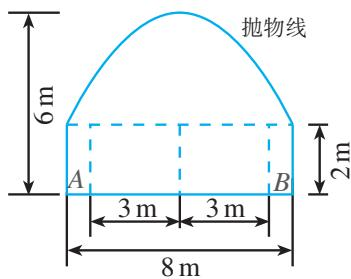

14. 如图，一隧道内设双行线公路，其截面由一个长方形和抛物线构成。为保证安全，要求行驶车辆顶部（设为平顶）与隧道顶部在竖直方向上高度之差至少要有 $0.5 \mathrm{~m}$ 。已知行车道总宽度 $|AB| = 6(\mathrm{~m})$ ，那么车辆通过隧道的限制高度是多少米？（精确到 $0.1 \mathrm{~m}$ ）

  
(第14题)

## 相关知识点

暂无已审核的相关知识点。

> 来源：高中选择性必修 第一册·人教A版数学
