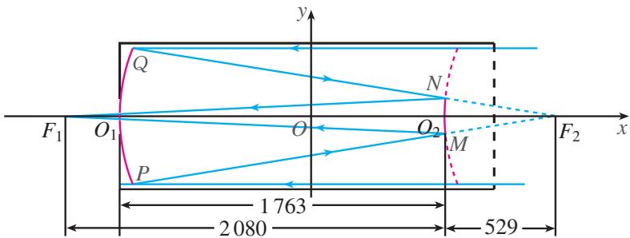

15. 综合应用抛物线和双曲线的光学性质，可以设计制造反射式天文望远镜。这种望远镜的特点是，镜筒可以很短而观察天体运动又很清楚。例如，某天文仪器厂设计制造的一种镜筒长为 $2 \mathrm{~m}$ 的反射式望远镜，其光学系统的原理如图（中心截口示意图）所示。其中，一个反射镜 $PO_{1}Q$ 弧所在的曲线为抛物线，另一个反射镜 $MO_{2}N$ 弧所在的曲线为双曲线的一个分支。已知 $F_{1}, F_{2}$ 是双曲线的两个焦点，其中 $F_{2}$ 同时又是抛物线的焦点，试根据图示尺寸（单位： $\mathrm{mm}$ ），分别求抛物线和双曲线的方程。

  
(第 15 题)
