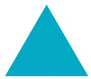

例4 图4.1-3中的一系列三角形图案称为谢尔宾斯基三角形。在图中4个大三角形中，着色的三角形的个数依次构成一个数列的前4项，写出这个数列的一个通项公式。

  
(1)

  
(2)

  
图4.1-3  
(3)

  
(4)

## 相关知识点

- [数列的概念与有穷性（范围关联）](../%E7%9F%A5%E8%AF%86%E7%82%B9/%E6%95%B0%E5%88%97%E7%9A%84%E6%A6%82%E5%BF%B5%E4%B8%8E%E6%9C%89%E7%A9%B7%E6%80%A7.md)
- [数列的通项公式（范围关联）](../%E7%9F%A5%E8%AF%86%E7%82%B9/%E6%95%B0%E5%88%97%E7%9A%84%E9%80%9A%E9%A1%B9%E5%85%AC%E5%BC%8F.md)
- [数列的前 n 项和及其与通项的关系（范围关联）](../%E7%9F%A5%E8%AF%86%E7%82%B9/%E6%95%B0%E5%88%97%E7%9A%84%E5%89%8D%20n%20%E9%A1%B9%E5%92%8C%E5%8F%8A%E5%85%B6%E4%B8%8E%E9%80%9A%E9%A1%B9%E7%9A%84%E5%85%B3%E7%B3%BB.md)
- [数列的递推公式（范围关联）](../%E7%9F%A5%E8%AF%86%E7%82%B9/%E6%95%B0%E5%88%97%E7%9A%84%E9%80%92%E6%8E%A8%E5%85%AC%E5%BC%8F.md)
- [数列的表示与单调性（范围关联）](../%E7%9F%A5%E8%AF%86%E7%82%B9/%E6%95%B0%E5%88%97%E7%9A%84%E8%A1%A8%E7%A4%BA%E4%B8%8E%E5%8D%95%E8%B0%83%E6%80%A7.md)
- [数列的函数观点（范围关联）](../%E7%9F%A5%E8%AF%86%E7%82%B9/%E6%95%B0%E5%88%97%E7%9A%84%E5%87%BD%E6%95%B0%E8%A7%82%E7%82%B9.md)

> 来源：高中选择性必修 第二册·人教A版数学
