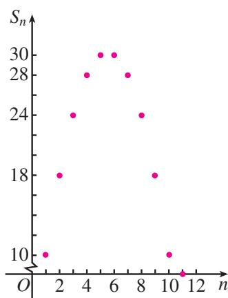

例 9 已知等差数列 $\{a_{n}\}$ 的前 n 项和为 $S_{n}$ ，若 $a_{1}=10$ ，公差 d=-2，则 $S_{n}$ 是否存在最大值？若存在，求 $S_{n}$ 的最大值及取得最大值时 n 的值；若不存在，请说明理由.

分析：由 $a_1 > 0$ 和 $d < 0$ ，可以证明 $\{a_n\}$ 是递减数列，且存在正整数 $k$ ，使得当 $n \geqslant k$ 时， $a_n < 0$ ， $S_n$ 递减．这样，就把求 $S_n$ 的最大值转化为求 $\{a_n\}$ 的所有正数项的和.

另一方面，等差数列的前 $n$ 项和公式可写成 $S_{n} = \frac{d}{2} n^{2} + (a_{1} - \frac{d}{2})n$ ，所以当 $d\neq 0$ 时， $S_{n}$ 可以看成二次函数 $y = \frac{d}{2} x^2 +$ $\left(a_1 - \frac{d}{2}\right)x(x\in \mathbf{R})$ 当 $x = n$ 时的函数值．如图4.2-4，当 $d <   0$ 时， $S_{n}$ 关于 $n$ 的图象是一条开口向下的抛物线上的一些点.因此，可以利用二次函数求相应的 $n$ ， $S_{n}$ 的值.

## 相关知识点

- [高斯求和与等差数列的对称性（范围关联）](../%E7%9F%A5%E8%AF%86%E7%82%B9/%E9%AB%98%E6%96%AF%E6%B1%82%E5%92%8C%E4%B8%8E%E7%AD%89%E5%B7%AE%E6%95%B0%E5%88%97%E7%9A%84%E5%AF%B9%E7%A7%B0%E6%80%A7.md)
- [倒序相加法与等差数列前 n 项和公式（范围关联）](../%E7%9F%A5%E8%AF%86%E7%82%B9/%E5%80%92%E5%BA%8F%E7%9B%B8%E5%8A%A0%E6%B3%95%E4%B8%8E%E7%AD%89%E5%B7%AE%E6%95%B0%E5%88%97%E5%89%8D%20n%20%E9%A1%B9%E5%92%8C%E5%85%AC%E5%BC%8F.md)

> 来源：高中选择性必修 第二册·人教A版数学
