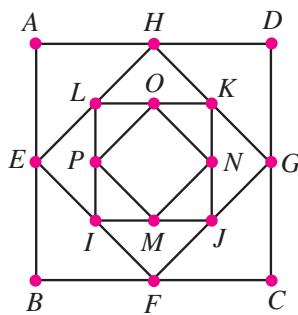

例 10 如图 4.3-2，正方形 ABCD 的边长为 5 cm，取正方形 ABCD 各边的中点 E，F，G，H，作第 2 个正方形 EFGH，然后再取正方形 EFGH 各边的中点 I，J，K，L，作第 3 个正方形 IJKL，依此方法一直继续下去.

（1）求从正方形ABCD开始，连续10个正方形的面积之和；

（2）如果这个作图过程可以一直继续下去，那么这些正方形的面积之和将趋近于多少？

图4.3-2

