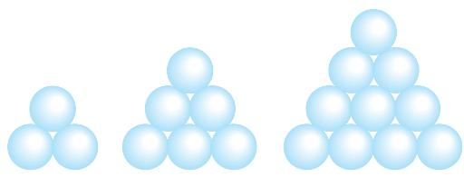

14. 在 2015 年苏州世乒赛期间，某景点用乒乓球堆成若干堆 “正三棱锥” 形的装饰品，其中第 1 堆只有 1 层，就一个球；第 2，3，4，…堆最底层（第一层）分别按图中所示方式固定摆放，从第二层开始，每层的小球自然垒放

从第二层开始，每层的小球自然垒放 (第14题)

在下一层之上，第 $n$ 堆第 $n$ 层就放一个乒乓球．记第 $n$ 堆的乒乓球总数为 $f(n)$

（2）试归纳出 $f(n+1)$ 与 $f(n)$ 的关系式，并根据你得到的关系式探求 $f(n)$ 的表达式.
参考公式： $1^{2}+2^{2}+\cdots+n^{2}=\frac{1}{6}n(n+1)(2n+1)$ .

## 相关知识点

暂无已审核的相关知识点。

> 来源：高中选择性必修 第二册·人教A版数学
