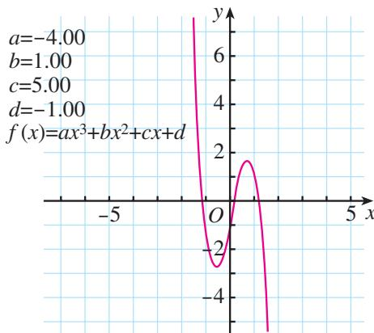

13. 利用信息技术工具，根据给定的 $a, b, c, d$ 的值，可以画出函数

$$
f (x) = a x ^ {3} + b x ^ {2} + c x + d \quad (a \neq 0)
$$

的图象，当 $a = -4, b = 1, c = 5, d = -1$ 时， $f(x)$ 的图象如图所示．改变 $a, b, c, d$ 的值，观察图象的形状：

（1）你能归纳函数 $f(x)$ 图象的大致形状吗？它的图象有什么特点？你能从图象上大致估计它的单调区间吗？

(2) 运用导数研究它的单调性，并求出相应的单调区间.

  
(第13题)

## 相关知识点

暂无已审核的相关知识点。

> 来源：高中选择性必修 第二册·人教A版数学
