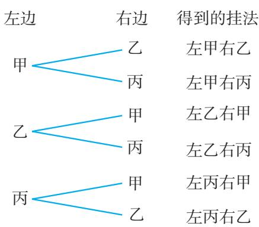
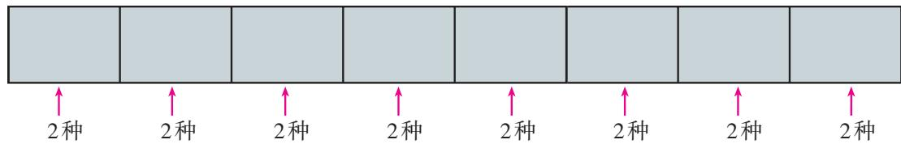

4. 现有高一年级的学生 3 名，高二年级的学生 5 名，高三年级的学生 4 名.

（1）从三个年级的学生中任选1人参加接待外宾的活动，有多少种不同的选法？

（2）从三个年级的学生中各选1人参加接待外宾的活动，有多少种不同的选法？

例4 要从甲、乙、丙3幅不同的画中选出2幅，分别挂在左、右两边墙上的指定位置，共有多少种不同的挂法？

分析：要完成的一件事是“从3幅画中选出2幅，并分别挂在左、右两边墙上”，可以分步完成.

解：从 3 幅画中选出 2 幅分别挂在左、右两边墙上，可以分两个步骤完成：第 1 步，从 3 幅画中选 1 幅挂在左边墙上，有 3 种选法；第 2 步，从剩下的 2 幅画中选 1 幅挂在右边墙上，有 2 种选法。根据分步乘法计数原理，不同挂法的种数为

$$
N = 3 \times 2 = 6.
$$

  
图6.1-2

这 6 种挂法如图 6.1-2 所示.

分类加法计数原理和分步乘法计数原理，回答的都是有关做一件事的不同方法种数的问题。区别在于：分类加法计数原理针对的是“分类”问题，其中各种方法相互独立，用其中任何一种方法都可以做完这件事；分步乘法计数原理针对的是“分步”问题，各个步骤中的方法互相依存，只有每一个步骤都完成才算做完这件事。

例 5 给程序模块命名，需要用 3 个字符，其中首字符要求用字母 A～G 或 U～Z，后两个字符要求用数字 1～9，最多可以给多少个程序模块命名？

分析：要完成的一件事是“给一个程序模块命名”，可以分三个步骤完成：第1步，选首字符；第2步，选中间字符；第3步，选最后一个字符．而首字符又可以分为两类．

解：由分类加法计数原理，首字符不同选法的种数为

$$
7 + 6 = 1 3.
$$

后两个字符从 1～9 中选，因为数字可以重复，所以不同选法的种数都为 9.

由分步乘法计数原理，不同名称的个数是

你还能给出不同的解法吗？

$$
1 3 \times 9 \times 9 = 1 0 5 3,
$$

即最多可以给 1053 个程序模块命名.

例6 电子元件很容易实现电路的通与断、电位的高与低等两种状态，而这也是最容易控制的两种状态。因此计算机内部就采用了每一位只有0或1两种数字的记数法，即二进制。为了使计算机能够识别字符，需要对字符进行编码，每个字符可以用1个或多个字节来表示，其中字节是计算机中数据存储的最小计量单位，每个字节由8个二进制位构成。

(1) 1个字节（8位）最多可以表示多少个不同的字符？

（2）计算机汉字国标码包含了6763个汉字，一个汉字为一个字符，要对这些汉字进行编码，每个汉字至少要用多少个字节表示？

分析：（1）要完成的一件事是“确定1个字节各二进制位上的数字”。由于每个字节有8个二进制位，每一位上的数字都有0，1两种选择，而且不同的顺序代表不同的字符，因此可以用分步乘法计数原理求解；（2）只要计算出多少个字节所能表示的不同字符不少于6763个即可。

解：（1）用图 6.1-3 表示 1 个字节，每一格代表一位.

  
图6.1-3

1 个字节共有 8 位，每位上有 2 种选择。根据分步乘法计数原理，1 个字节最多可以表示不同字符的个数是

$$
2 \times 2 \times 2 \times 2 \times 2 \times 2 \times 2 \times 2 = 2 ^ {8} = 2 5 6.
$$

（2）由（1）知，1个字节所能表示的不同字符不够6763个，我们考虑2个字节能够表示多少个字符.前1个字节有256种不同的表示方法，后1个字节也有256种表示方法.根据分步乘法计数原理，2个字节可以表示不同字符的个数是

$$
2 5 6 \times 2 5 6 = 6 5 5 3 6.
$$

这已经大于汉字国标码包含的汉字个数 6763. 因此要对这些汉字进行编码，每个汉字至少要用 2 个字节表示.

## 相关知识点

- [分类加法计数原理（范围关联）](../%E7%9F%A5%E8%AF%86%E7%82%B9/%E5%88%86%E7%B1%BB%E5%8A%A0%E6%B3%95%E8%AE%A1%E6%95%B0%E5%8E%9F%E7%90%86.md)
- [分步乘法计数原理（范围关联）](../%E7%9F%A5%E8%AF%86%E7%82%B9/%E5%88%86%E6%AD%A5%E4%B9%98%E6%B3%95%E8%AE%A1%E6%95%B0%E5%8E%9F%E7%90%86.md)

> 来源：高中选择性必修 第三册·人教A版数学
