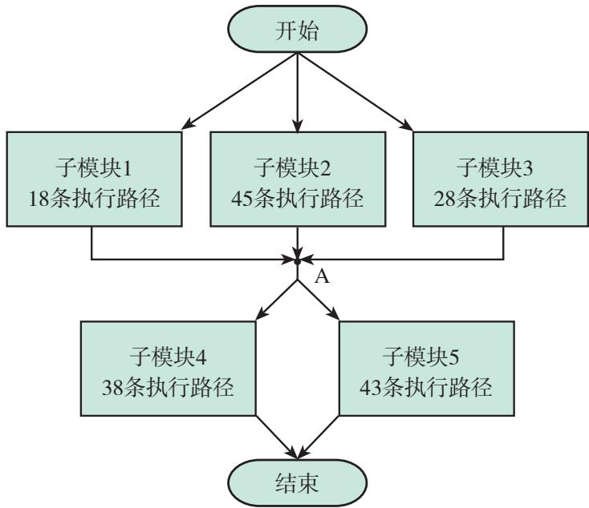
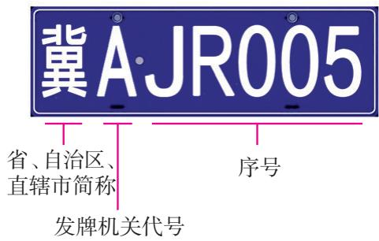

5. 由数字 1, 2, 3, 4, 5 可以组成多少个三位数（各位上的数字可以重复）?

第六章 计数原理

例7 计算机编程人员在编写好程序以后需要对程序进行测试。程序员需要知道到底有多少条执行路径（程序从开始到结束的路线），以便知道需要提供多少个测试数据。一般地，一个程序模块由许多子模块组成。图6.1-4是一个具有许多执行路径的程序模块，它有多少条执行路径？

另外，为了减少测试时间，程序员需要设法减少测试次数。你能帮助程序员设计一个测试方法，以减少测试次数吗？

  
图6.1-4

分析：整个模块的任意一条执行路径都分两步完成：第1步是从开始执行到A点；第2步是从A点执行到结束。而第1步可由子模块1、子模块2、子模块3中任何一个来完成；第2步可由子模块4、子模块5中任何一个来完成。因此，分析一条指令在整个模块的执行路径需要用到两个计数原理。

解：由分类加法计数原理，子模块1、子模块2、子模块3中的子路径条数共为

$$
1 8 + 4 5 + 2 8 = 9 1;
$$

子模块4、子模块5中的子路径条数共为

$$
3 8 + 4 3 = 8 1.
$$

又由分步乘法计数原理，整个模块的执行路径条数共为

$$
9 1 \times 8 1 = 7 3 7 1.
$$

在实际测试中，程序员总是把每一个子模块看成一个黑箱，即通过只考察是否执行了正确的子模块的方式来测试整个模块。这样，他可以先分别单独测试5个模块，以考察每个子模块的工作是否正常。总共需要的测试次数为

$$
1 8 + 4 5 + 2 8 + 3 8 + 4 3 = 1 7 2.
$$

再测试各个模块之间的信息交流是否正常，只需要测试程序第1步中的各个子模块和第2步中的各个子模块之间的信息交流是否正常，需要的测试次数为

$$
3 \times 2 = 6.
$$

如果每个子模块都工作正常，并且各个子模块之间的信息交流也正常，那么整个程序模块就工作正常。这样，测试整个模块的次数就变为

$$
1 7 2 + 6 = 1 7 8.
$$

显然，178与7371的差距是非常大的.

你看出了程序员是如何实现减少测试次数的吗？

例 8 通常，我国民用汽车号牌的编号由两部分组成：第一部分为用汉字表示的省、自治区、直辖市简称和用英文字母表示的发牌机关代号，第二部分为由阿拉伯数字和英文字母组成的序号，如图 6.1-5 所示.

  
图6.1-5

对于省和自治区，发牌机关通常是指其地级市的公共交通管理部门，并用英文字母依次编码。例如，河北省石家庄市、唐山市的发牌机关代号分别为A，B.直辖市的发牌机关代号可备案后依次自行使用。

其中，序号的编码规则为：

（1）由 10 个阿拉伯数字和除 O，I 之外的 24 个英文字母组成；

(2) 最多只能有 2 个英文字母.

如果某地级市发牌机关采用5位序号编码，那么这个发牌机关最多能发放多少张汽车号牌？

分析：由号牌编号的组成可知，序号的个数决定了这个发牌机关所能发放的最多号牌数。按序号编码规则可知，每个序号中的数字、字母都是可重复的，并且可将序号分为三类：没有字母，有1个字母，有2个字母。以字母所在位置为分类标准，可将有1个字母的序号分为五个子类，将有2个字母的序号分为十个子类。

解：由号牌编号的组成可知，这个发牌机关所能发放的最多号牌数就是序号的个数。根据序号编码规则，5位序号可以分为三类：没有字母，有1个字母，有2个字母。

（1）当没有字母时，序号的每一位都是数字．确定一个序号可以分5个步骤，每一步都可以从10个数字中选1个，各有10种选法．根据分步乘法计数原理，这类号牌张数为

$$
1 0 \times 1 0 \times 1 0 \times 1 0 \times 1 0 = 1 0 0 0 0 0.
$$

（2）当有 1 个字母时，这个字母可以分别在序号的第 1 位、第 2 位、第 3 位、第 4 位或第 5 位，这类序号可以分为五个子类.

当第1位是字母时，分5个步骤确定一个序号中的字母和数字：第1步，从24个字母中选 1 个放在第 1 位，有 24 种选法；第 2～5 步都是从 10 个数字中选 1 个放在相应的位置，各有 10 种选法。根据分步乘法计数原理，号牌张数为

$$
2 4 \times 1 0 \times 1 0 \times 1 0 \times 1 0 = 2 4 0 0 0 0.
$$

同样，其余四个子类号牌也各有 240 000 张.

根据分类加法计数原理，这类号牌张数一共为

$$
2 4 0 0 0 0 + 2 4 0 0 0 0 + 2 4 0 0 0 0 + 2 4 0 0 0 0 + 2 4 0 0 0 0 = 1 2 0 0 0 0 0.
$$

（3）当有 2 个字母时，根据这 2 个字母在序号中的位置，可以将这类序号分为十个子类：第 1 位和第 2 位，第 1 位和第 3 位，第 1 位和第 4 位，第 1 位和第 5 位，第 2 位和第 3 位，第 2 位和第 4 位，第 2 位和第 5 位，第 3 位和第 4 位，第 3 位和第 5 位，第 4 位和第 5 位.

当第 1 位和第 2 位是字母时，分 5 个步骤确定一个序号中的字母和数字：第 1，2 步都是从 24 个字母中选 1 个分别放在第 1 位、第 2 位，各有 24 种选法；第 3～5 步都是从 10 个数字中选 1 个放在相应的位置，各有 10 种选法。根据分步乘法计数原理，号牌张数为

$$
2 4 \times 2 4 \times 1 0 \times 1 0 \times 1 0 = 5 7 6 0 0 0.
$$

同样，其余九个子类号牌也各有 576 000 张.

于是，这类号牌张数一共为

$$
5 7 6 0 0 0 \times 1 0 = 5 7 6 0 0 0 0.
$$

综合（1）(2)(3)，根据分类加法计数原理，这个发牌机关最多能发放的汽车号牌张数为

$$
1 0 0 0 0 0 + 1 2 0 0 0 0 0 + 5 7 6 0 0 0 0 = 7 0 6 0 0 0 0.
$$

用两个计数原理解决计数问题时，最重要的是在开始计算之前要仔细分析两点：（1）要完成的“一件事”是什么；（2）需要分类还是需要分步.

分类要做到“不重不漏”。分类后再分别对每一类进行计数，最后用分类加法计数原理求和，得到总数。

分步要做到“步骤完整”，即完成了所有步骤，才能完成任务。分步后再计算每一步的方法数，最后根据分步乘法计数原理，把完成每一步的方法数相乘，得到总数。

思考

乘法运算是特定条件下加法运算的简化，分步乘法计数原理和分类加法计数原理也有这种类似的关系吗？

## 相关知识点

- [分类加法计数原理（范围关联）](../%E7%9F%A5%E8%AF%86%E7%82%B9/%E5%88%86%E7%B1%BB%E5%8A%A0%E6%B3%95%E8%AE%A1%E6%95%B0%E5%8E%9F%E7%90%86.md)
- [分步乘法计数原理（范围关联）](../%E7%9F%A5%E8%AF%86%E7%82%B9/%E5%88%86%E6%AD%A5%E4%B9%98%E6%B3%95%E8%AE%A1%E6%95%B0%E5%8E%9F%E7%90%86.md)

> 来源：高中选择性必修 第三册·人教A版数学
