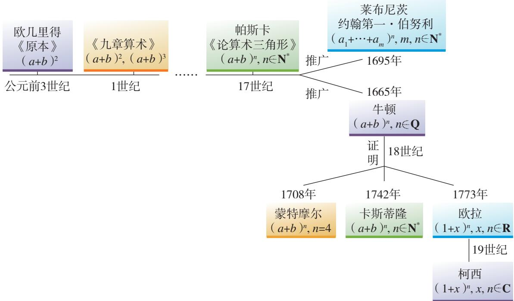

11. 下图反映了二项式定理产生、完备和推广所走过的漫长历程：

  
(第11题)

（1）在上述发展过程中，无论是推广还是证明，都是从特殊到一般。如今，数学研究的一个发展趋势就是尽可能地一般化。请你试一试，从 $(a+b)^{n}$ 推广到 $(a_{1}+a_{2}+\cdots+a_{m})^{n}$ $(m, n\in\mathbf{N}^{*})$ 。

（2）请你查阅相关资料，细化上述历程中的某段过程，例如从3次到 $n$ 次，从二项到 $m$ 项等，说一说数学家是如何发现问题和解决问题的.

## 相关知识点

暂无已审核的相关知识点。

> 来源：高中选择性必修 第三册·人教A版数学
