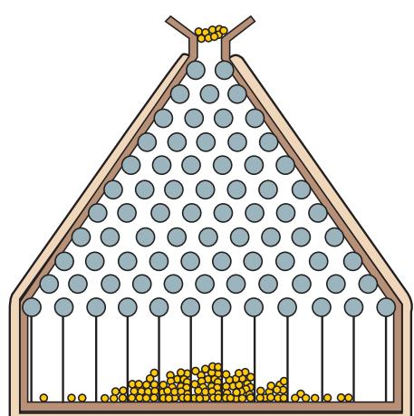
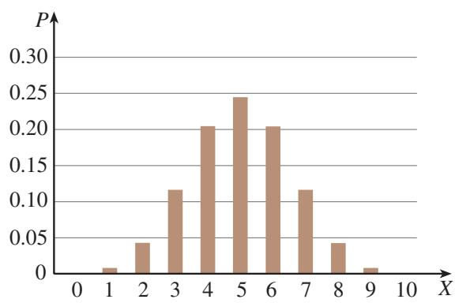

例 2 图 7.4-2 是一块高尔顿板的示意图。在一块木板上钉着若干排相互平行但相互错开的圆柱形小木钉，小木钉之间留有适当的空隙作为通道，前面挡有一块玻璃。将小球从顶端放入，小球下落的过程中，每次碰到小木钉后都等可能地向左或向右落下，最后落入底部的格子中。格子从左到右分别编号为 0, 1, 2, …, 10，用 X 表示小球最后落入格子的号码，求 X 的分布列。

## 题目补充材料（来源原文）

图7.4-2  
  
图7.4-3

## 相关知识点

- [伯努利试验与n重伯努利试验（范围关联）](../%E7%9F%A5%E8%AF%86%E7%82%B9/%E4%BC%AF%E5%8A%AA%E5%88%A9%E8%AF%95%E9%AA%8C%E4%B8%8En%E9%87%8D%E4%BC%AF%E5%8A%AA%E5%88%A9%E8%AF%95%E9%AA%8C.md)
- [二项分布的均值与方差（范围关联）](../%E7%9F%A5%E8%AF%86%E7%82%B9/%E4%BA%8C%E9%A1%B9%E5%88%86%E5%B8%83%E7%9A%84%E5%9D%87%E5%80%BC%E4%B8%8E%E6%96%B9%E5%B7%AE.md)
- [二项分布的概率公式（范围关联）](../%E7%9F%A5%E8%AF%86%E7%82%B9/%E4%BA%8C%E9%A1%B9%E5%88%86%E5%B8%83%E7%9A%84%E6%A6%82%E7%8E%87%E5%85%AC%E5%BC%8F.md)

> 来源：高中选择性必修 第三册·人教A版数学
