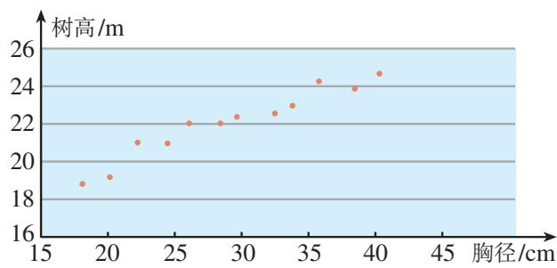
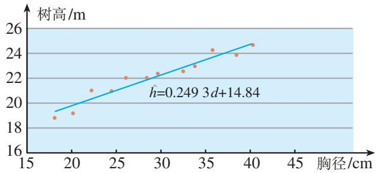
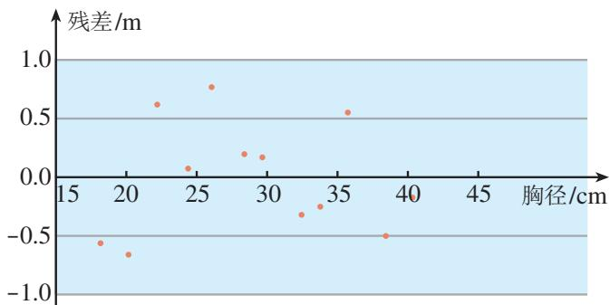
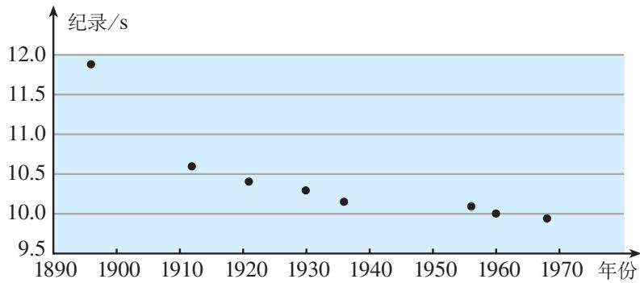
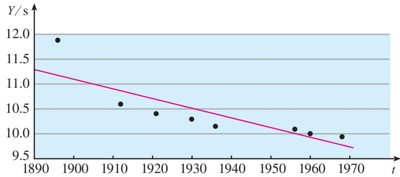
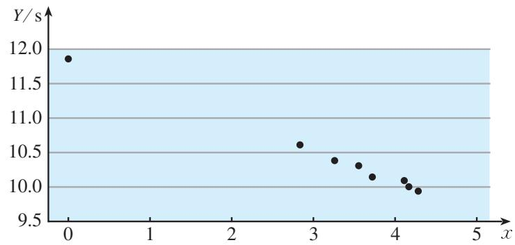
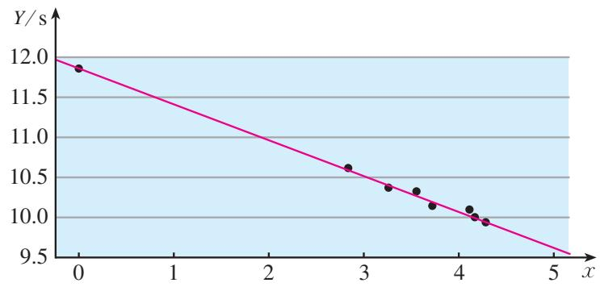
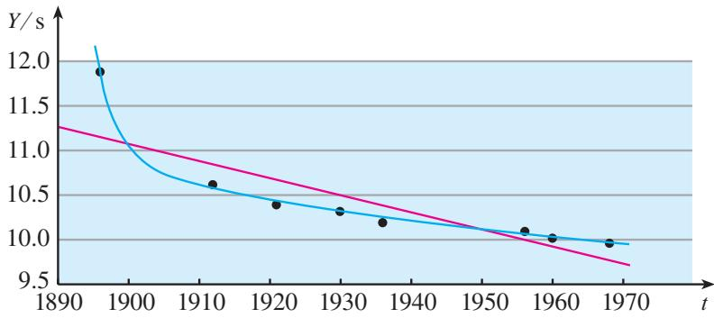
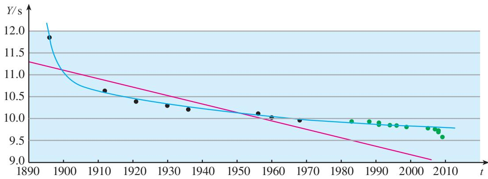

5. 假设变量 x 与变量 Y 的 n 对观测数据为 $(x_{1}, y_{1})$ ， $(x_{2}, y_{2})$ ，…， $(x_{n}, y_{n})$ ，两个变量满足一元线性回归模型

$$
\left\{ \begin{array}{l} Y = b x + e, \\ E (e) = 0, D (e) = \sigma^ {2}. \end{array} \right.
$$

请写出参数 b 的最小二乘估计.

例 经验表明，一般树的胸径（树的主干在地面以上 $1.3\mathrm{m}$ 处的直径）越大，树就越高。由于测量树高比测量胸径困难，因此研究人员希望由胸径预测树高。在研究树高与胸径之间的关系时，某林场收集了某种树的一些数据（表8.2-3），试根据这些数据建立树高关于胸径的经验回归方程。

表8.2-3

<table><tr><td>编号</td><td>1</td><td>2</td><td>3</td><td>4</td><td>5</td><td>6</td></tr><tr><td>胸径/cm</td><td>18.1</td><td>20.1</td><td>22.2</td><td>24.4</td><td>26.0</td><td>28.3</td></tr><tr><td>树高/m</td><td>18.8</td><td>19.2</td><td>21.0</td><td>21.0</td><td>22.1</td><td>22.1</td></tr><tr><td>编号</td><td>7</td><td>8</td><td>9</td><td>10</td><td>11</td><td>12</td></tr><tr><td>胸径/cm</td><td>29.6</td><td>32.4</td><td>33.7</td><td>35.7</td><td>38.3</td><td>40.2</td></tr><tr><td>树高/m</td><td>22.4</td><td>22.6</td><td>23.0</td><td>24.3</td><td>23.9</td><td>24.7</td></tr></table>

分析：因为要由胸径预测树高，所以要以成对样本数据的胸径为横坐标、树高为纵坐标画出散点，进而得到散点图，再根据散点图推断树高与胸径是否线性相关．如果是，再

利用公式（2）计算出 $\hat{b}$ ， $\hat{a}$ 即可.

解：以胸径为横坐标、树高为纵坐标作散点图，得到图 8.2-9.

在图 8.2-9 中，散点大致分布在一条从左下角到右上角的直线附近，表明两个变量线性相关，并且是正相关，因此可以用一元线性回归模型刻画树高与胸径之间的关系.

  
图8.2-9

用 $d$ 表示胸径， $h$ 表示树高，根据最小二乘法，计算可得经验回归方程为 $\hat{h} = 0.2493d + 14.84$

相应的经验回归直线如图 8.2-10 所示.

  
图8.2-10

根据经验回归方程，由表8.2-3中胸径的数据可以计算出树高的预测值（精确到0.1）以及相应的残差，如表8.2-4所示.

表8.2-4

<table><tr><td>编号</td><td>胸径/cm</td><td>树高观测值/m</td><td>树高预测值/m</td><td>残差/m</td></tr><tr><td>1</td><td>18.1</td><td>18.8</td><td>19.4</td><td>-0.6</td></tr><tr><td>2</td><td>20.1</td><td>19.2</td><td>19.9</td><td>-0.7</td></tr><tr><td>3</td><td>22.2</td><td>21.0</td><td>20.4</td><td>0.6</td></tr><tr><td>4</td><td>24.4</td><td>21.0</td><td>20.9</td><td>0.1</td></tr><tr><td>5</td><td>26.0</td><td>22.1</td><td>21.3</td><td>0.8</td></tr><tr><td>6</td><td>28.3</td><td>22.1</td><td>21.9</td><td>0.2</td></tr><tr><td>7</td><td>29.6</td><td>22.4</td><td>22.2</td><td>0.2</td></tr><tr><td>8</td><td>32.4</td><td>22.6</td><td>22.9</td><td>-0.3</td></tr><tr><td>9</td><td>33.7</td><td>23.0</td><td>23.2</td><td>-0.2</td></tr><tr><td>10</td><td>35.7</td><td>24.3</td><td>23.7</td><td>0.6</td></tr><tr><td>11</td><td>38.3</td><td>23.9</td><td>24.4</td><td>-0.5</td></tr><tr><td>12</td><td>40.2</td><td>24.7</td><td>24.9</td><td>-0.2</td></tr></table>

以胸径为横坐标，残差为纵坐标，作残差图，得到图 8.2-11.

  
图8.2-11

观察残差表和残差图，可以看到，残差的绝对值最大是0.8，所有残差分布在以横轴为对称轴、宽度小于2的带状区域内。可见经验回归方程较好地刻画了树高与胸径的关系，我们可以根据经验回归方程由胸径预测树高。

114 第八章 成对数据的统计分析

问题 人们常将男子短跑 $100\mathrm{m}$ 的高水平运动员称为“百米飞人”。表8.2-5给出了1968年之前男子短跑 $100\mathrm{m}$ 世界纪录产生的年份和世界纪录的数据。试依据这些成对数据，建立男子短跑 $100\mathrm{m}$ 世界纪录关于纪录产生年份的经验回归方程。

表8.2-5

<table><tr><td>编号</td><td>1</td><td>2</td><td>3</td><td>4</td><td>5</td><td>6</td><td>7</td><td>8</td></tr><tr><td>年份</td><td>1896</td><td>1912</td><td>1921</td><td>1930</td><td>1936</td><td>1956</td><td>1960</td><td>1968</td></tr><tr><td>纪录/s</td><td>11.80</td><td>10.60</td><td>10.40</td><td>10.30</td><td>10.20</td><td>10.10</td><td>10.00</td><td>9.95</td></tr></table>

以成对数据中的世界纪录产生年份为横坐标，世界纪录为纵坐标作散点图，得到图8.2-12.

  
图8.2-12

在图8.2-12中，散点看上去大致分布在一条直线附近，似乎可用一元线性回归模型建立经验回归方程.

用 Y 表示男子短跑 100 m 的世界纪录，t 表示纪录产生的年份，利用一元线性回归模型

$$
\left\{ \begin{array}{l} Y = b t + a + e, \\ E (e) = 0, D (e) = \sigma^ {2} \end{array} \right.
$$

来刻画世界纪录和世界纪录产生年份之间的关系. 根据最小二乘法, 由表中的数据得到经验回归方程为

$$
\hat {y} _ {1} = - 0. 0 2 0 3 3 7 4 3 t + 4 9. 7 6 9 1 3 0 3 1.\tag{①}
$$

将经验回归直线叠加到散点图，得到图 8.2-13.

  
图8.2-13

观察

从图8.2-13中可以看到，经验回归方程①较好地刻画了散点的变化趋势．请再仔细观察图形，你能看出其中存在的问题吗？

以经验回归直线为参照，可以发现经验回归方程的不足之处，以及散点的更为精细的分布特征。例如，第一个世界纪录所对应的散点远离经验回归直线，并且前后两时间段中的散点都在经验回归直线的上方，中间时间段的散点都在经验回归直线的下方。这说明散点并不是随机分布在经验回归直线的周围，而是围绕着经验回归直线有一定的变化规律，即成对样本数据呈现出明显的非线性相关的特征。

思考

你能对模型进行修改，以使其更好地反映散点的分布特征吗？

仔细观察图8.2-12，可以发现散点更趋向于落在中间下凸且递减的某条曲线附近。回顾已有的函数知识，可以发现函数 $y = -\ln x$ 的图象具有类似的形状特征。注意到 $100\mathrm{m}$ 短跑的第一个世界纪录产生于1896年，因此可以认为散点是集中在曲线

$$
y = f (t) = c _ {1} + c _ {2} \ln (t - 1 8 9 5)
$$

的周围，其中 $c_{1}$ 和 $c_{2}$ 为未知的参数，且 $c_{2}<0$ .

用上述函数刻画数据变化的趋势，这是一个非线性经验回归函数，其中 $c_{1}$ ， $c_{2}$ 是待定参数。现在问题转化为如何利用成对数据估计参数 $c_{1}$ 和 $c_{2}$ 。

为了利用一元线性回归模型估计参数 $c_{1}$ 和 $c_{2}$ ，我们引进一个中间变量 $x$ ，令 $x = \ln (t - 1895)$ 。通过 $x = \ln (t - 1895)$ ，将年份变量数据进行变换，得到新的成对数据（精确到0.01），如表8.2-6所示。

表8.2-6

<table><tr><td>编号</td><td>1</td><td>2</td><td>3</td><td>4</td><td>5</td><td>6</td><td>7</td><td>8</td></tr><tr><td>x</td><td>0.00</td><td>2.83</td><td>3.26</td><td>3.56</td><td>3.71</td><td>4.11</td><td>4.17</td><td>4.29</td></tr><tr><td>Y/s</td><td>11.80</td><td>10.60</td><td>10.40</td><td>10.30</td><td>10.20</td><td>10.10</td><td>10.00</td><td>9.95</td></tr></table>

如果表8.2-6对应的散点图呈现出很强的线性相关特征，我们就可以借助一元线性回归模型和新的成对数据，对参数 $c_{1}$ 和 $c_{2}$ 作出估计，进而可以得到 $Y$ 关于 $t$ 的非线性经验回归方程.

在直角坐标系中画出表8.2-6中成对数据的散点图，如图8.2-14所示，散点的分布呈现出很强的线性相关特征.

第八章 成对数据的统计分析

  
图8.2-14  
因此，用一元线性回归模型

$$
\left\{ \begin{array}{l} Y = c _ {2} x + c _ {1} + u, \\ E (u) = 0, D (u) = \delta^ {2} \end{array} \right.
$$

拟合表8.2-6中的成对数据，得到经验回归方程

$$
\hat {y} _ {2} = - 0. 4 2 6 4 3 9 8 x + 1 1. 8 0 1 2 6 5 3,\tag{*}
$$

再在图 8.2-14 中画出（\*）式所对应的经验回归直线，得到图 8.2-15.

  
图8.2-15

图8.2-15表明，经验回归方程（ $*$ ）对于表8.2-6中的成对数据具有非常好的拟合精度。将图8.2-15与图8.2-13进行对比，可以发现 $x$ 和 $Y$ 之间的线性相关程度比原始样本数据的线性相关程度强得多。

将 $x = \ln (t - 1895)$ 代入（ $*$ ）式，得到由创纪录年份预报世界纪录的经验回归方程

$$
\hat {y} _ {2} = - 0. 4 2 6 4 3 9 8 \ln (t - 1 8 9 5) + 1 1. 8 0 1 2 6 5 3.\tag{②}
$$

在同一直角坐标系中画出成对数据散点图、非线性经验回归方程②的图象（蓝色）以及经验回归方程①的图象（红色），如图8.2-16所示．我们发现，散点图中各散点都非常靠近②的图象，表明非线性经验回归方程②对于原始数据的拟合效果远远好于经验回归方程①.

下面通过残差来比较这两个经验回归方程对数据刻画的好坏。在表8.2-5中，用 $t_i$ 表示编号为 $i$ 的年份数据，用 $y_i$ 表示编号为 $i$ 的纪录数据，则经验回归方程①和②的残差计算公式分别为

$$
\hat {e} _ {i} = y _ {i} + 0. 0 2 0 3 3 7 4 3 t _ {i} - 4 9. 7 6 9 1 3 0 3 1, i = 1, 2, \dots , 8;
$$

$$
\hat {u} _ {i} = y _ {i} + 0. 4 2 6 4 3 9 8 \ln (t _ {i} - 1 8 9 5) - 1 1. 8 0 1 2 6 5 3, i = 1, 2, \dots , 8.
$$

  
图8.2-16

两个经验回归方程的残差（精确到0.001）如表8.2-7所示。观察各项残差的绝对值，发现经验回归方程②远远小于①，即经验回归方程②的拟合效果要远远好于①。

表8.2-7

<table><tr><td>编号</td><td>1</td><td>2</td><td>3</td><td>4</td><td>5</td><td>6</td><td>7</td><td>8</td></tr><tr><td>t</td><td>1896</td><td>1912</td><td>1921</td><td>1930</td><td>1936</td><td>1956</td><td>1960</td><td>1968</td></tr><tr><td> $\hat{e}$ </td><td>0.591</td><td>-0.284</td><td>-0.301</td><td>-0.218</td><td>-0.196</td><td>0.111</td><td>0.092</td><td>0.205</td></tr><tr><td> $\hat{u}$ </td><td>-0.001</td><td>0.007</td><td>-0.012</td><td>0.015</td><td>-0.018</td><td>0.052</td><td>-0.021</td><td>-0.022</td></tr></table>

在一般情况下，直接比较两个模型的残差比较困难，因为在某些散点上一个模型的残差的绝对值比另一个模型的小，而另一些散点的情况则相反．可以通过比较残差的平方和来比较两个模型的效果．由

$$
Q _ {1} = \sum_ {i = 1} ^ {8} (\hat {e} _ {i}) ^ {2} \approx 0. 6 6 9, Q _ {2} = \sum_ {i = 1} ^ {8} (\hat {u} _ {i}) ^ {2} \approx 0. 0 0 4,
$$

可知 $Q_{2}$ 小于 $Q_{1}$ ，因此在残差平方和最小的标准下，非线性回归模型

$$
\left\{ \begin{array}{l} Y = c _ {2} \ln (t - 1 8 9 5) + c _ {1} + u, \\ E (u) = 0, D (u) = \delta^ {2} \end{array} \right.
$$

的拟合效果要优于一元线性回归模型的拟合效果.

也可以用决定系数 $R^2$ 来比较两个模型的拟合效果， $R^2$ 的计算公式为

$$
R ^ {2} = 1 - \frac {\sum_ {i = 1} ^ {n} \left(y _ {i} - \hat {y} _ {i}\right) ^ {2}}{\sum_ {i = 1} ^ {n} \left(y _ {i} - \overline {{{{y}}}}\right) ^ {2}}.
$$

在 $R^2$ 表达式中， $\sum_{i = 1}^{n}(y_i - \overline{y})^2$ 与经验回归方程无关，残差平方和 $\sum_{i = 1}^{n}(y_i - \hat{y}_i)^2$ 与经验回归方程有关．因此 $R^2$ 越大，表示残差平方和越小，即模型的拟合效果越好； $R^2$ 越小，表示残差平方和越大，即模型的拟合效果越差.

由表 8.2-7 容易算出经验回归方程①和②的 $R^{2}$ 分别约为 0.7325 和 0.9983，因此经验回归方程②的刻画效果比经验回归方程①的好很多.

另外，我们还可以用新的观测数据来检验模型的拟合效果。事实上，我们还有1968年之后的男子短跑 $100\mathrm{m}$ 世界纪录数据，如表8.2-8所示。

第八章 成对数据的统计分析

表8.2-8

<table><tr><td>编号</td><td>9</td><td>10</td><td>11</td><td>12</td><td>13</td><td>14</td></tr><tr><td>t</td><td>1983</td><td>1988</td><td>1991</td><td>1991</td><td>1994</td><td>1996</td></tr><tr><td>Y/s</td><td>9.93</td><td>9.92</td><td>9.90</td><td>9.86</td><td>9.85</td><td>9.84</td></tr><tr><td>编号</td><td>15</td><td>16</td><td>17</td><td>18</td><td>19</td><td>20</td></tr><tr><td>t</td><td>1999</td><td>2005</td><td>2007</td><td>2008</td><td>2008</td><td>2009</td></tr><tr><td>Y/s</td><td>9.79</td><td>9.77</td><td>9.74</td><td>9.72</td><td>9.69</td><td>9.58</td></tr></table>

在散点图8.2-12中，绘制表8.2-8中的散点（绿色），再添加经验回归方程①所对应的经验回归直线（红色），以及经验回归方程②所对应的经验回归曲线（蓝色），得到图8.2-17．显然绿色散点分布在蓝色经验回归曲线的附近，远离红色经验回归直线，表明经验回归方程②对于新数据的预报效果远远好于①.

  
图8.2-17

思考

在上述问题情境中，男子短跑 $100\mathrm{m}$ 世界纪录和纪录产生年份之间呈现出对数关系，能借助于样本相关系数刻画这种关系的强弱吗？

在使用经验回归方程进行预测时，需要注意下列问题：

（1）经验回归方程只适用于所研究的样本的总体。例如，根据我国父亲身高与儿子身高的数据建立的经验回归方程，不能用来描述美国父亲身高与儿子身高之间的关系。同样，根据生长在南方多雨地区的树高与胸径的数据建立的经验回归方程，不能用来描述北方干旱地区的树高与胸径之间的关系。

（2）经验回归方程一般都有时效性．例如，根据20世纪80年代的父亲身高与儿子身高的数据建立的经验回归方程，不能用来描述现在的父亲身高与儿子身高之间的关系.

（3）解释变量的取值不能离样本数据的范围太远。一般解释变量的取值在样本数据范围内，经验回归方程的预报效果会比较好，超出这个范围越远，预报的效果越差。

（4）不能期望经验回归方程得到的预报值就是响应变量的精确值。事实上，它是响应变量的可能取值的平均值。
