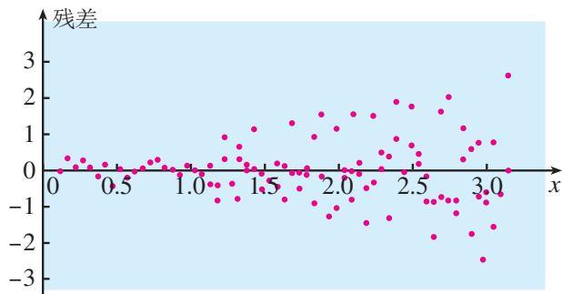

2. 根据变量 Y 和 x 的成对样本数据，由一元线性回归模型 $\left\{\begin{aligned}Y&=bx+a+e,\\ E(e)&=0,D(e)=\sigma^{2}\end{aligned}\right.$ 得到经验回归模型 $\hat{y}=\hat{b}x+\hat{a}$ ，对应的残差如图所示．模型误差（）.

  
(第2题)

(A) 满足一元线性回归模型的所有假设

(B) 不满足一元线性回归模型的 $E(e) = 0$ 的假设

(C) 不满足一元线性回归模型的 $D(e) = \sigma^2$ 的假设

(D) 不满足一元线性回归模型的 $E(e) = 0$ 和 $D(e) = \sigma^2$ 的假设

## 相关知识点

暂无已审核的相关知识点。

> 来源：高中选择性必修 第三册·人教A版数学
