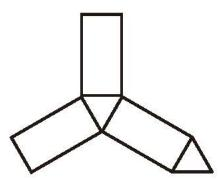
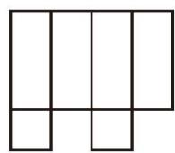

2. 图中的两个图形经过折叠能否围成棱柱？先想一想，再折一折。

(1)

(第2题)

(2)

## 相关知识点

- [圆柱与圆锥的侧面展开图特征（范围关联）](../%E7%9F%A5%E8%AF%86%E7%82%B9/%E5%9C%86%E6%9F%B1%E4%B8%8E%E5%9C%86%E9%94%A5%E7%9A%84%E4%BE%A7%E9%9D%A2%E5%B1%95%E5%BC%80%E5%9B%BE%E7%89%B9%E5%BE%81.md)

> 来源：北师大版初中数学·七年级上册
