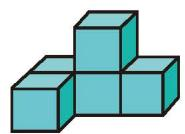
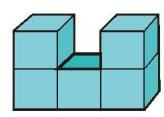
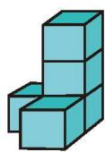
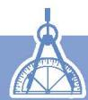

1. 用 5 个大小相同的小立方块分别搭成如图所示的几何体。请你用自己的方式描述一下每个几何体的具体形状。

(1)

(2) (第1题)

(3)

## 相关知识点

- [从正面、左面和上面三个方向看物体的形状图（范围关联）](../%E7%9F%A5%E8%AF%86%E7%82%B9/%E4%BB%8E%E6%AD%A3%E9%9D%A2%E3%80%81%E5%B7%A6%E9%9D%A2%E5%92%8C%E4%B8%8A%E9%9D%A2%E4%B8%89%E4%B8%AA%E6%96%B9%E5%90%91%E7%9C%8B%E7%89%A9%E4%BD%93%E7%9A%84%E5%BD%A2%E7%8A%B6%E5%9B%BE.md)

> 来源：北师大版初中数学·七年级上册
