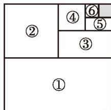

11. 如图, 将一张边长为 1 的正方形纸片分割成 7 部分,部分①的面积是边长为 1 的正方形纸片面积的一半,部分②的面积是部分①面积的一半,部分③的面积是部分②面积的一半,依此类推。

(1) 阴影部分的面积是多少?

※（2）试求出 $\frac{1}{2} +\frac{1}{4} +\frac{1}{8} +\dots +\frac{1}{2^6}$ 的值。

(第11题)

## 相关知识点

暂无已审核的相关知识点。

> 来源：北师大版初中数学·七年级上册
