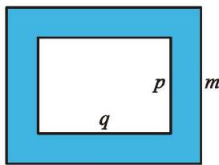

1. (1) 小明步行上学, 速度为 $\nu \mathrm{m} / \mathrm{s}$ ; 小亮骑自行车上学, 速度是小明的 3 倍, 则小亮的速度可以表示为 \_\_\_\_ m/s。

(2) 如图, 用字母表示图中阴影部分的面积。

## 相关知识点

- [代数式的概念与求代数式的值（范围关联）](../%E7%9F%A5%E8%AF%86%E7%82%B9/%E4%BB%A3%E6%95%B0%E5%BC%8F%E7%9A%84%E6%A6%82%E5%BF%B5%E4%B8%8E%E6%B1%82%E4%BB%A3%E6%95%B0%E5%BC%8F%E7%9A%84%E5%80%BC.md)

> 来源：北师大版初中数学·七年级上册
