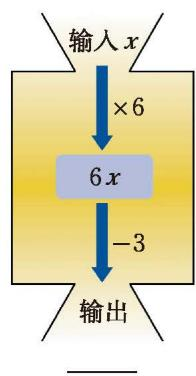
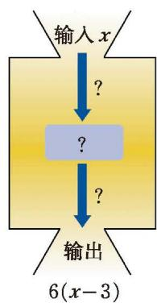

2. 在计算机上可以设置运算程序, 输入一组数据, 计算机就会呈现运算结果, 就好像一个 “数值转换机”。右面是一组 “数值转换机”, 请填写下表, 并写出图

(1) 的输出结果、图

(2) 的运算过程。

(1)

(2)

(第2题)

<table><tr><td>输入</td><td>-2</td><td> $-\frac{1}{2}$ </td><td>0</td><td>0.26</td><td> $\frac{1}{3}$ </td><td> $\frac{5}{2}$ </td><td>4.5</td></tr><tr><td>图(1)的输出结果</td><td></td><td></td><td></td><td></td><td></td><td></td><td></td></tr><tr><td>图(2)的输出结果</td><td></td><td></td><td></td><td></td><td></td><td></td><td></td></tr></table>
