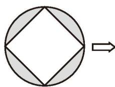
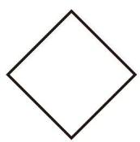
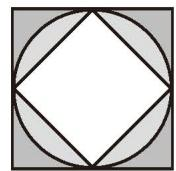
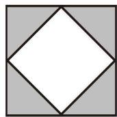

17. 如图(1)(2), 某餐桌桌面可由圆形折叠成正方形 (图中阴影表示可折叠部分)。已知折叠前圆形桌面的直径为 $a \mathrm{~m}$ , 折叠成正方形后其边长为 $b \mathrm{~m}$ 。如果一块正方形桌布的边长为 $a \mathrm{~m}$ , 并按图(3)所示把它铺在折叠前的圆形桌面上, 那么桌布垂下部分的面积是多少? 如果按图(4)所示把这块桌布铺在折叠后的正方形桌面上呢?

(1)

(2)

(第17题)
(3)

(4)

