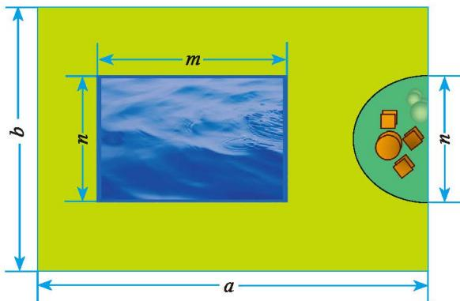

10. 小华为一个长方形休闲场所提供了如图所示的设计方案, 其中半圆形休息区和长方形游泳区外的地方都是绿地。如果这个休闲场所需要有一半以上的绿地, 并且它的长与宽之间满足 $a = \frac{3}{2} b$ , 而小华设计的 $m$ , $n$ 分别是 $a, b$ 的 $\frac{1}{2}$ , 那么他的设计方案符合要求吗? 请你为这个休闲场所提供一个既符合要求又美观的设计方案。

(第10题)
