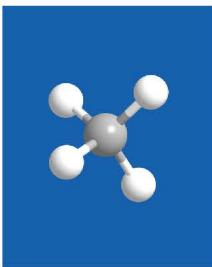
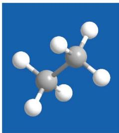
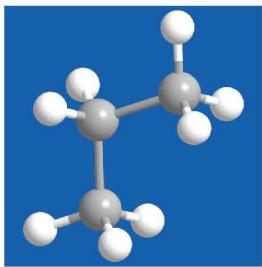
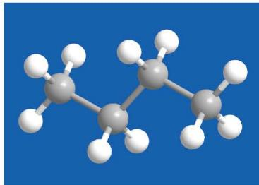
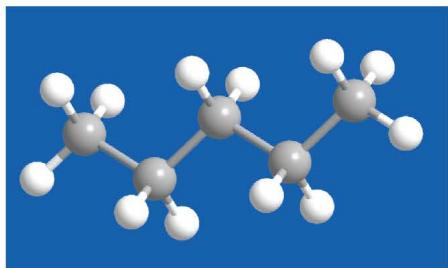
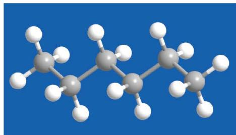

4. 某类简单化合物中前 6 种化合物的分子结构模型如图 3-14 所示, 其中灰球代表碳原子, 白球代表氢原子。按照这一规律, 第 60 种化合物的分子结构模型中有多少个氢原子?

①

②

③

④

⑤

图3-14

⑥

## 相关知识点

- [归纳策略的数学思想与含义（范围关联）](../%E7%9F%A5%E8%AF%86%E7%82%B9/%E5%BD%92%E7%BA%B3%E7%AD%96%E7%95%A5%E7%9A%84%E6%95%B0%E5%AD%A6%E6%80%9D%E6%83%B3%E4%B8%8E%E5%90%AB%E4%B9%89.md)
- [小明的归纳策略解答示范：低多边形内分三角形规律与证明（范围关联）](../%E7%9F%A5%E8%AF%86%E7%82%B9/%E5%B0%8F%E6%98%8E%E7%9A%84%E5%BD%92%E7%BA%B3%E7%AD%96%E7%95%A5%E8%A7%A3%E7%AD%94%E7%A4%BA%E8%8C%83%EF%BC%9A%E4%BD%8E%E5%A4%9A%E8%BE%B9%E5%BD%A2%E5%86%85%E5%88%86%E4%B8%89%E8%A7%92%E5%BD%A2%E8%A7%84%E5%BE%8B%E4%B8%8E%E8%AF%81%E6%98%8E.md)
- [运用归纳策略寻找规律的一般步骤总结（范围关联）](../%E7%9F%A5%E8%AF%86%E7%82%B9/%E8%BF%90%E7%94%A8%E5%BD%92%E7%BA%B3%E7%AD%96%E7%95%A5%E5%AF%BB%E6%89%BE%E8%A7%84%E5%BE%8B%E7%9A%84%E4%B8%80%E8%88%AC%E6%AD%A5%E9%AA%A4%E6%80%BB%E7%BB%93.md)

> 来源：北师大版初中数学·七年级上册
