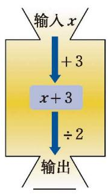
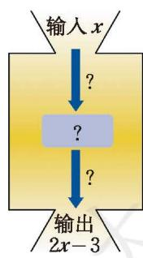

2. 一组“数值转换机”如图所示，请填写下表，并写出图（1）的输出结果、图（2）的运算过程。

(1)

(第2题)
(2)

<table><tr><td>输入x</td><td>-2</td><td>-1</td><td>-1/2</td><td>0</td><td>1</td><td>1.5</td></tr><tr><td>图(1)的输出结果</td><td></td><td></td><td></td><td></td><td></td><td></td></tr><tr><td>图(2)的输出结果</td><td></td><td></td><td></td><td></td><td></td><td></td></tr></table>

## 相关知识点

暂无已审核的相关知识点。

> 来源：北师大版初中数学·七年级上册
