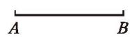

5. 如图, 已知线段 ${AB}$ ,请用尺规按下列步骤作图：

(1) 延长线段 $AB$ 到 $C$ , 使 $BC = AB$ ;

(2) 延长线段 BA 到 D，使 AD = AC。

如果 AB=2 cm，那么 AC=\_\_\_\_ cm，BD=\_\_\_\_ cm，CD=\_\_\_\_ cm。

(第5题)

## 相关知识点

暂无已审核的相关知识点。

> 来源：北师大版初中数学·七年级上册
