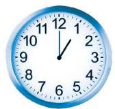
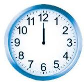
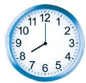
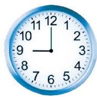

8. (1) 如图, 分别确定四个城市相应钟表上时针与分针所成角的度数。

巴黎

伦敦

(第8题)
北京

东京

(2) 每经过 $1 \mathrm{~h}$ , 时针转过多少度? 每经过 $1 \mathrm{~min}$ , 分针转过多少度?

(3) 当时钟指向上午 10:10 时, 时针与分针的夹角是多少度? ※

(4) 请你的同伴任意报一个时间 (精确到分), 你来确定时针与分针的夹角。
