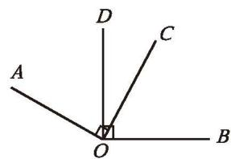
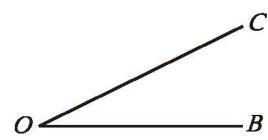

9. 如图 (1), $\angle AOC$ 和 $\angle BOD$ 都是直角。

(1) 如果 $\angle DOC = 28^{\circ}$ , 那么 $\angle AOB$ 的度数是多少?

(2) 找出图 (1) 中相等的角。如果 $\angle DOC \neq 28^{\circ}$ , 它们还会相等吗?

(3) 如果 $\angle DOC$ 变小, 那么 $\angle AOB$ 如何变化?

(1)

(2)
(第9题)

(4) 在图 (2) 中利用能够画直角的工具再画一个与 $\angle COB$ 相等的角。

## 相关知识点

暂无已审核的相关知识点。

> 来源：北师大版初中数学·七年级上册
