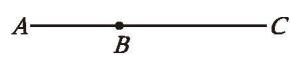

3. 如图, $\angle ABC$ 是平角, 过点 $B$ 任作一条射线 $BD$ , 得到 $\angle DBA$ 与 $\angle DBC$ 。当 $\angle DBA$ 分别是什么角时, $\angle DBA < \angle DBC$ , $\angle DBA > \angle DBC$ , $\angle DBA = \angle DBC$ ?

(第3题)

## 相关知识点

暂无已审核的相关知识点。

> 来源：北师大版初中数学·七年级上册
