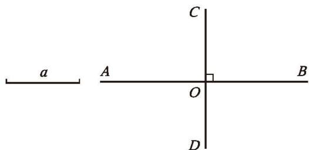

8. 如图, 已知线段 $a$ , 直线 $AB$ 与直线 $CD$ 相交于点 $O$ , 请用尺规按下列要求作图:

(1) 在射线 $OA, OB, OC, OD$ 上作线段 $OA', OB', OC', OD'$ , 使它们分别与线段 $a$ 相等;

(2) 连接 $A^{\prime} C^{\prime}, C^{\prime} B^{\prime}, B^{\prime} D^{\prime}, D^{\prime} A^{\prime}$ 。

你得到了一个怎样的图形？

(第8题)

## 相关知识点

暂无已审核的相关知识点。

> 来源：北师大版初中数学·七年级上册
