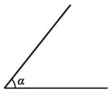
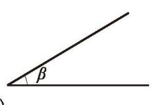
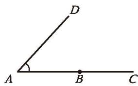

9. 用尺规完成下列作图：

(1) 如图 (1), 已知 $\angle \alpha, \angle \beta$ , 且 $\angle \alpha > \angle \beta$ , 作 $\angle DEF$ , 使 $\angle DEF = \angle \alpha - \angle \beta$ ;

(2)如图(2),以点 $B$ 为顶点、射线 ${BC}$ 为一边,作 $\angle {EBC}$ ,使 $\angle {EBC} = \angle A$ 。

(1)

(第9题)

(2)
