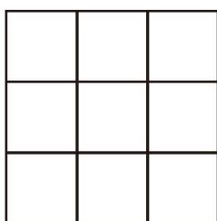

18. 图中的正方形由9个小方格组成。在每个小方格中各填一个数，如果每行、每列、每条对角线上的三个数的和都相等，那么就称
这个图是一个三阶幻方。

(第18题)

(1) 请将 $1 \sim 9$ 这 9 个数填入图中的小方格中, 构造一个三阶幻方。

(2) 改变 (1) 中所构造的三阶幻方中某些数的位置, 构造一个新的三阶幻方。

(3) 在 (1)(2) 所构造的不同三阶幻方中, 有没有位置始终不变的数? 如果有, 请你解释其中的道理。

(4) 你能选择其他9个数构造一个三阶幻方吗？请你试一试。
