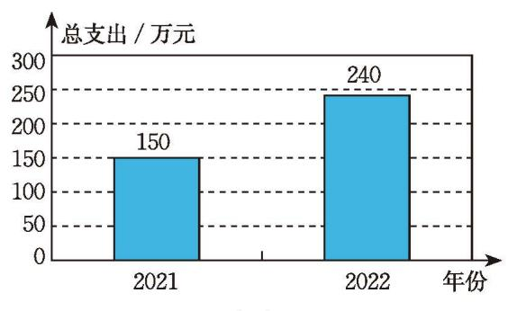
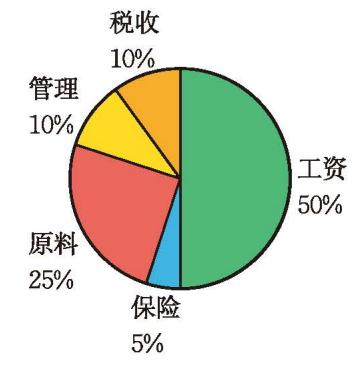

6. 某公司 2021—2022 年的总支出情况如图所示。

某公司 2021—2022 年总支出情况

某公司 2022 年总支出的分配情况

(1) 2022年该公司原料的支出金额是多少？工资的支出金额是多少？

(2) 2021年该公司的工资支出占总支出的 $60\%$ , 2022年与2021年相比, 该公司在工资方面的支出金额是增加了还是减少了?

## 相关知识点

暂无已审核的相关知识点。

> 来源：北师大版初中数学·七年级上册
