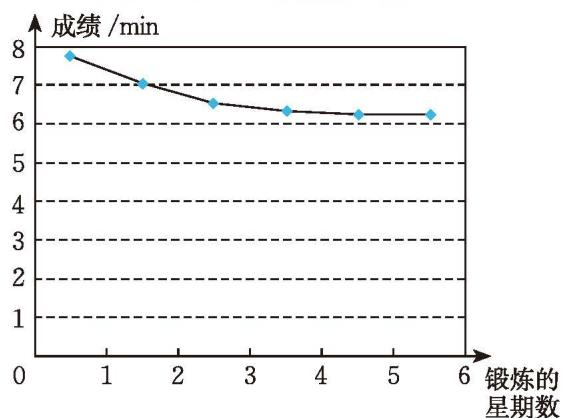

14. 为提高长跑成绩，小彬坚持锻炼并于每星期日记录下 $1500 \mathrm{~m}$ 成绩。

小彬 1500 m 成绩统计表

<table><tr><td>锻炼的星期数</td><td>1</td><td>2</td><td>3</td><td>4</td><td>5</td><td>6</td></tr><tr><td>小彬的成绩</td><td>7 min 42 s</td><td>7 min</td><td>6 min 30 s</td><td>6 min 18 s</td><td>6 min 12 s</td><td>6 min 12 s</td></tr></table>

小彬 1 500 m 成绩统计图

(第14题)

如果要更清楚地看出小彬成绩的变化情况，你选择统计图还是统计表？如果要方便、准确地获得他锻炼5星期后的长跑成绩，你会如何选择？
