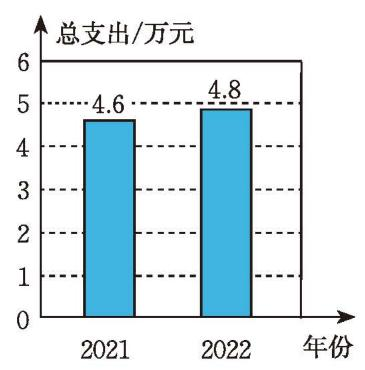
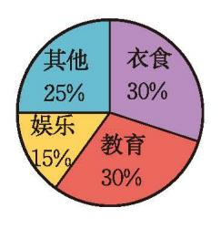
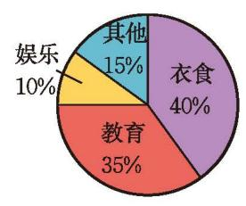

14. 小刚家 2021 年和 2022 年的家庭总支出情况如图所示。

2021年、2022年总支出情况

(1)

2021年总支出情况

2022年总支出情况

(第14题)

(1) 2022年总支出比2021年增加了多少万元？增加的百分比是多少？

(2) 2021年衣食方面支出的金额是多少? 教育方面支出的金额是多少?

(3) 2022年娱乐方面支出的金额比2021年增加了还是减少了？变化了多少？
