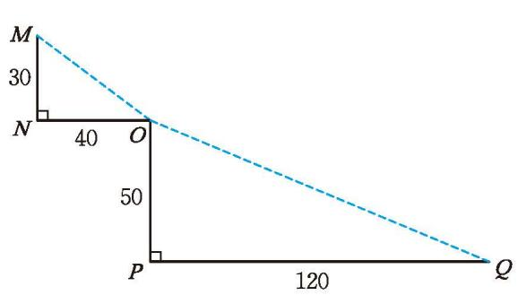

1. 右图是某沿江地区交通平面图的一部分（单位：km），为了加快经济发展，该地区拟修建一条连接 M, O, Q 三城市的沿江高速公路，已知沿江高速公路的建设成本是 5000 万元/km，该沿江高速公路的建设成本预计是多少？

(第1题)

## 相关知识点

- [阅读·思考：勾股定理的无字证明（范围关联）](../%E7%9F%A5%E8%AF%86%E7%82%B9/%E9%98%85%E8%AF%BB%C2%B7%E6%80%9D%E8%80%83%EF%BC%9A%E5%8B%BE%E8%82%A1%E5%AE%9A%E7%90%86%E7%9A%84%E6%97%A0%E5%AD%97%E8%AF%81%E6%98%8E.md)
- [勾股定理的拼图验证与赵爽弦图（范围关联）](../%E7%9F%A5%E8%AF%86%E7%82%B9/%E5%8B%BE%E8%82%A1%E5%AE%9A%E7%90%86%E7%9A%84%E6%8B%BC%E5%9B%BE%E9%AA%8C%E8%AF%81%E4%B8%8E%E8%B5%B5%E7%88%BD%E5%BC%A6%E5%9B%BE.md)

> 来源：北师大版初中数学·八年级上册
