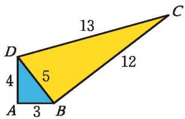

例 一个零件的形状如图 1-14 所示, 按规定这个零件中 $\angle A$ 和 $\angle DBC$ 都应为直角。工人师傅量得这个零件各边尺寸如图 1-15 所示 (单位: cm), 这个零件符合要求吗?

图 1-14

图 1-15

## 相关知识点

- [勾股定理的逆定理（直角三角形的判定）与勾股数（范围关联）](../%E7%9F%A5%E8%AF%86%E7%82%B9/%E5%8B%BE%E8%82%A1%E5%AE%9A%E7%90%86%E7%9A%84%E9%80%86%E5%AE%9A%E7%90%86%EF%BC%88%E7%9B%B4%E8%A7%92%E4%B8%89%E8%A7%92%E5%BD%A2%E7%9A%84%E5%88%A4%E5%AE%9A%EF%BC%89%E4%B8%8E%E5%8B%BE%E8%82%A1%E6%95%B0.md)

> 来源：北师大版初中数学·八年级上册
