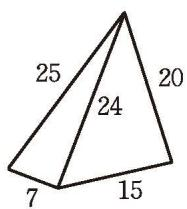
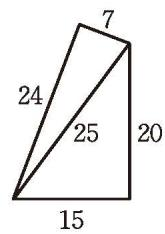
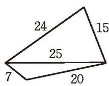

1. 五根小木棒的长度分别是 $7 \mathrm{~cm}, 15 \mathrm{~cm}, 20 \mathrm{~cm}, 24 \mathrm{~cm}, 25 \mathrm{~cm}$ , 现将它们摆成两个直角三角形, 如图所示的三个图形中哪个是正确的?

(1)

(2)

(第1题)

(3)

## 相关知识点

暂无已审核的相关知识点。

> 来源：北师大版初中数学·八年级上册
