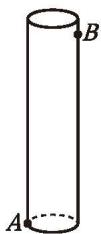
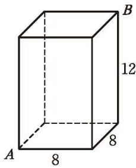

请你解答下列问题。

1. 解决下列几个问题，并说明它们与本节课问题的区别与联系。

(1) 如图 1-21, 圆柱的高为 $13 \mathrm{~cm}$ , 底面周长为 $10 \mathrm{~cm}$ , 在圆柱下底面的点 $A$ 处有一只蚂蚁, 它想吃到与点 $A$ 相对、离上底面 $1 \mathrm{~cm}$ 的点 $B$ 处的食物, 那么它沿圆柱侧面爬行的最短路程是多少?

图1-21

(2) 如图 1-22, 一个长方体形盒子的长、宽、高分别是 $8 \mathrm{~cm}, 8 \mathrm{~cm}, 12 \mathrm{~cm}$ , 一只蚂蚁想从盒底的点 $A$ 处沿盒的外表面爬到盒顶的点 $B$ 处, 你能帮蚂蚁设计一条最短的路线吗? 蚂蚁爬行的最短路程是多少?

图1-22

(3) 为了营造节日气氛, 学校准备在大厅圆柱上缠绕彩带。已知大厅圆柱的高为 $6 \mathrm{~m}$ , 底面周长为 $2 \mathrm{~m}$ 。如果希望彩带从圆柱底端绕圆柱 4 圈后正好到达顶端, 那么至少需要彩带多少米?

## 相关知识点

- [问题解决策略：反思的四个环节与方法体系（范围关联）](../%E7%9F%A5%E8%AF%86%E7%82%B9/%E9%97%AE%E9%A2%98%E8%A7%A3%E5%86%B3%E7%AD%96%E7%95%A5%EF%BC%9A%E5%8F%8D%E6%80%9D%E7%9A%84%E5%9B%9B%E4%B8%AA%E7%8E%AF%E8%8A%82%E4%B8%8E%E6%96%B9%E6%B3%95%E4%BD%93%E7%B3%BB.md)

> 来源：北师大版初中数学·八年级上册
