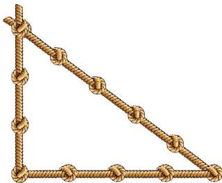

5. 据说古埃及人曾用下面的方法得到直角: 如图所示, 他们用 13 个等距的结把一根绳子的一部分分成等长的 12 段, 一个人同时握住绳子的第 1 个结和第 13 个结, 另两个人分别握住第 4 个结和第 8 个结, 拉紧绳子, 就会得到一个直角三角形, 其直角顶点在第 4 个结处。请你说说其中的道理。

(第5题)

## 相关知识点

暂无已审核的相关知识点。

> 来源：北师大版初中数学·八年级上册
