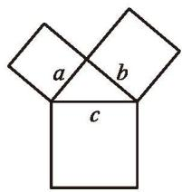
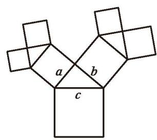

7. 如图 ①, 直角三角形的两个锐角分别是 $40^{\circ}$ 和 $50^{\circ}$ , 它的三边上各有一个正方形。执行下面的操作: 分别以两个小正方形的边为斜边, 向外作一个锐角为 $40^{\circ}$ 的直角三角形; 再分别

以所得到的直角三角形的直角边为边，向直角三角形外作正方形。图②是1次操作后得到的图形。

①

②
(第7题)

(1) 试画出 2 次操作后得到的图形。

(2)已知最初的直角三角形斜边长 $c$ 为 $1 \mathrm{~cm}$ , 写出 2 次操作后得到的图形中所有正方形的面积和。

(3) 如果一直画下去, 你能想象出它的样子吗? 请借助数学软件进行探索。

(4) 重复上述步骤若干次后得到的图形称为 “毕达哥拉斯树”。如果最初的直角三角形是等腰直角三角形, 那么此时 “毕达哥拉斯树” 会是什么形状?

## 相关知识点

暂无已审核的相关知识点。

> 来源：北师大版初中数学·八年级上册
