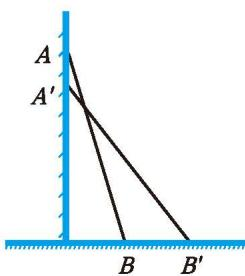

9. 一架云梯长 $25 \mathrm{~m}$ , 如图那样斜靠在一面墙上。当这架云梯的顶端位于 $A$ 处时, 它的底端位于 $B$ 处, 底端离墙 $7 \mathrm{~m}$ 。

(1) 这架云梯的顶端到地面的距离是多少?

(2)当这架云梯的顶端从 $A$ 处下滑 $4 \mathrm{~m}$ 到达 $A'$ 处时, 它的底端从 $B$ 处滑动到 $B'$ 处, 云梯底端在水平方向滑动的距离也是 $4 \mathrm{~m}$ 吗?

(第9题)

## 相关知识点

暂无已审核的相关知识点。

> 来源：北师大版初中数学·八年级上册
