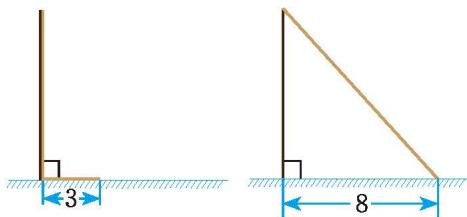

※12. 今有立木，系索其末，委地三尺。引索却行，去本八尺而索尽。问：索长几何？（选自《九章算术》）

题目大意: 在直立于地面的一根木杆顶端系一根绳索, 绳索自然下垂后拖在地面上的长度为 3 尺 (如图)。在距木杆底端 8 尺处的地面拉紧绳索, 整根绳索恰好被拉直。这根绳索有多长?

将这个问题一般化, 即已知直角三角形的勾长 $a$ , 弦长与股长的差为 $d$ , 求弦长 $c$ 。

(1) 试用 $a, d$ 表示 $c$ ;

(2) 查阅资料, 了解《九章算术》解决这类问题的思路与方法。

(第12题)
