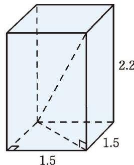

※14. (1) 大家知道 (3, 4, 5) (5, 12, 13) (8, 15, 17) 都是勾股数组。有人说勾股数组中一定有一个偶数，你认为这种观点正确吗？请说明你的理由。

(2) 你还能发现勾股数组具有哪些规律？与同伴进行交流。

(第13题)

(3) 小明发现: 很多已经约去公因数的勾股数组中, 都有一个数是偶数, 如果将它写成 $2mn$ , 那么另外两个数分别可以写成 $m^{2} + n^{2}$ , $m^{2} - n^{2}$ , 如 $4 = 2 \times 2 \times 1$ , $5 = 2^{2} + 1^{2}$ , $3 = 2^{2} - 1^{2}$ 。再找几个勾股数组, 看看他发现的规律是否正确。满足这个规律的数组都是勾股数组吗?
