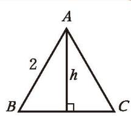

1. 如图，等边三角形 $ABC$ 的边长为 2，高为 $h, h$ 可能是有理数吗？

(第1题)

## 相关知识点

- [无限不循环小数与非有理数的数值特征（范围关联）](../%E7%9F%A5%E8%AF%86%E7%82%B9/%E6%97%A0%E9%99%90%E4%B8%8D%E5%BE%AA%E7%8E%AF%E5%B0%8F%E6%95%B0%E4%B8%8E%E9%9D%9E%E6%9C%89%E7%90%86%E6%95%B0%E7%9A%84%E6%95%B0%E5%80%BC%E7%89%B9%E5%BE%81.md)
- [非有理数客观存在的初步认识（范围关联）](../%E7%9F%A5%E8%AF%86%E7%82%B9/%E9%9D%9E%E6%9C%89%E7%90%86%E6%95%B0%E5%AE%A2%E8%A7%82%E5%AD%98%E5%9C%A8%E7%9A%84%E5%88%9D%E6%AD%A5%E8%AE%A4%E8%AF%86.md)

> 来源：北师大版初中数学·八年级上册
