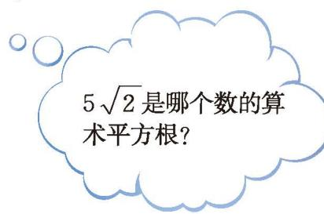

1. 计算：

(1) $\sqrt{5} \times \sqrt{\frac{9}{20}}$ ;

(2) $(1 + \sqrt{3})(2 - \sqrt{3})$ ;

(3) $(2\sqrt{3} - 1)^2;$

(4) $\left(\sqrt{27} + \sqrt{\frac{1}{3}}\right) \times \sqrt{3}$ ;

(5) $\frac{\sqrt{27} - \sqrt{12}}{\sqrt{3}}$ ;

(6) $\left(\sqrt{\frac{9}{2}} - \frac{\sqrt{98}}{3}\right) \times \sqrt{2}$ 。

