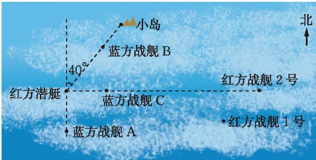

例 我国海军某舰艇编队在某海域展开实兵对抗训练，红蓝双方的对阵情况如图 3-1 所示（图中 1 cm 表示 20 n mile）。对红方潜艇来说：

(1) 北偏东 $40^{\circ}$ 方向上有哪些目标? 要确定蓝方战舰 B 的位置, 还需要什么数据?

(2) 距离红方潜艇 20 n mile 的蓝方战舰有哪几艘?

(3) 要确定每艘蓝方战舰的位置, 各需要几个数据?

图3-1

## 相关知识点

- [阅读·欣赏：平面定位的方式与经纬度原理（范围关联）](../%E7%9F%A5%E8%AF%86%E7%82%B9/%E9%98%85%E8%AF%BB%C2%B7%E6%AC%A3%E8%B5%8F%EF%BC%9A%E5%B9%B3%E9%9D%A2%E5%AE%9A%E4%BD%8D%E7%9A%84%E6%96%B9%E5%BC%8F%E4%B8%8E%E7%BB%8F%E7%BA%AC%E5%BA%A6%E5%8E%9F%E7%90%86.md)
- [平面内确定物体位置一般需要两个数据（范围关联）](../%E7%9F%A5%E8%AF%86%E7%82%B9/%E5%B9%B3%E9%9D%A2%E5%86%85%E7%A1%AE%E5%AE%9A%E7%89%A9%E4%BD%93%E4%BD%8D%E7%BD%AE%E4%B8%80%E8%88%AC%E9%9C%80%E8%A6%81%E4%B8%A4%E4%B8%AA%E6%95%B0%E6%8D%AE.md)

> 来源：北师大版初中数学·八年级上册
