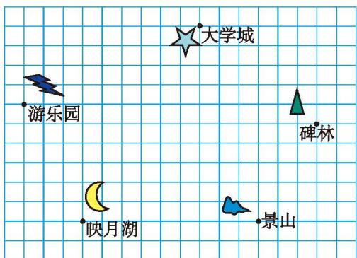

7. 小明在下图所示的旅游简图上建立了平面直角坐标系，并写出了五个景点的坐标，但他只告诉小颖大学城的坐标是（2，6），景山的坐标是（5，-4）。聪明的小颖想了想，就在图中准确画出了平面直角坐标系，并说出了其他景点的坐标。你知道小颖是怎么做的吗？画出相应的平面直角坐标系，并写出其他景点的坐标。

(第7题)

## 相关知识点

暂无已审核的相关知识点。

> 来源：北师大版初中数学·八年级上册
