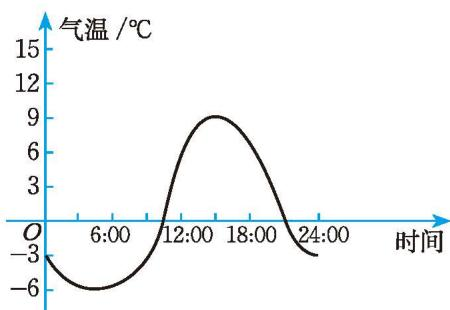

1. 下列各题中分别有几个变量？其中某个变量能看成另一个变量的函数吗？若能，请写出自变量的取值范围。

(1) 北京市某天气温的变化情况如图所示;

[第1(1)题]

(2) 在平整的路面上, 某型号汽车紧急刹车后仍会滑行 $s \mathrm{~m}$ , 一般地, 有经验公式 $s = \frac{\nu^2}{300}$ , 其中 $\nu$ 表示刹车前汽车的速度 (单位: $\mathrm{km/h}$ );

(3) 在国内, 将质量在 $100 \mathrm{~g}$ 以内的普通信函投寄到外埠, 应付邮资见下表:

<table><tr><td>信件质量 m/g</td><td>0 &lt; m ≤ 20</td><td>20 &lt; m ≤ 40</td><td>40 &lt; m ≤ 60</td><td>60 &lt; m ≤ 80</td><td>80 &lt; m ≤ 100</td></tr><tr><td>邮资 y/元</td><td>1.20</td><td>2.40</td><td>3.60</td><td>4.80</td><td>6.00</td></tr></table>

