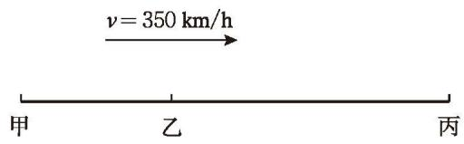

2. 如图, 甲、乙两地相距 $500 \mathrm{~km}$ , 一列 “复兴号” 动车组列车从乙地出发,以 $350 \mathrm{~km} / \mathrm{h}$ 的速度向丙地行驶。设 $x$ (单位: $\mathrm{h}$ ) 表示列车行驶的时间, $y$ (单位: $\mathrm{km}$ ) 表示列车与甲地之间的距离。

(1)写出 $y$ 与 $x$ 之间的关系式, 并判断 $y$ 是否为 $x$ 的一次函数;

(2) 当 x=0.5 时，求 y 的值。

(第2题)
