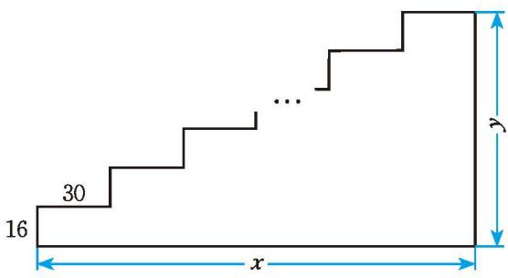

2. 如图, 一个楼梯有 $n$ 级台阶, 每级台阶宽 $30 \mathrm{~cm}$ 、高 $16 \mathrm{~cm}$ 。设这个楼梯的竖直高度为 $y \mathrm{~cm}$ , 侧面宽度为 $x \mathrm{~cm}$ 。

(第2题)

(1) 写出 x 与 n 之间的关系式;

(2)写出 $y$ 与 $n$ 之间的关系式;

(3) 写出 y 与 x 之间的关系式;

※（4）你能借助楼梯估计一幢高楼的高度吗？说说你的想法。
