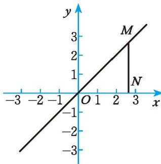

※7. 小明是这样理解“函数 $y = x$ 的图象是一条经过原点的直线”的：如图，当 $x = 0$ 时， $y = 0$ ，所以原点（0，0）在函数 $y = x$ 的图象上；当 $x = t$ 时， $y = t$ ，即 $MN = ON, \angle MON = 45^\circ$ ，而这个结论对任意的 $t$ 值都成立，所以函数 $y = x$ 的图象是一条经过原点、与横轴成 $45^\circ$ 角的直线。请你解释他的想法。

(第7题)
