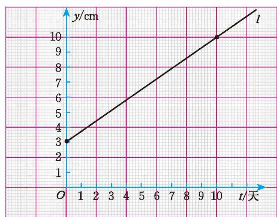

1. 如图，某植物栽种后经过 $t$ 天的高度为 $y \mathrm{~cm}, l$ 表示 $y$ 与 $t$ 之间的关系。根据图象回答下列问题：

(1) 该植物刚栽种时有多高?

(2) 该植物栽种后经过 10 天的高度为多少? 经过 4 天呢?

(3) 写出 $l$ 对应的函数表达式 $y = kt + b$ , 其中 $k$ 和 $b$ 的实际意义分别是什么?

(4) 该植物何时长到 $8 \mathrm{~cm}$ ?

(第1题)

(5) 按照图中呈现的规律, 预计该植物栽种后经过几天长到 $17 \mathrm{~cm}$ ?

## 相关知识点

- [一次函数与一元一次方程的关系（函数值为0与直线同x轴交点）（范围关联）](../%E7%9F%A5%E8%AF%86%E7%82%B9/%E4%B8%80%E6%AC%A1%E5%87%BD%E6%95%B0%E4%B8%8E%E4%B8%80%E5%85%83%E4%B8%80%E6%AC%A1%E6%96%B9%E7%A8%8B%E7%9A%84%E5%85%B3%E7%B3%BB%EF%BC%88%E5%87%BD%E6%95%B0%E5%80%BC%E4%B8%BA0%E4%B8%8E%E7%9B%B4%E7%BA%BF%E5%90%8Cx%E8%BD%B4%E4%BA%A4%E7%82%B9%EF%BC%89.md)

> 来源：北师大版初中数学·八年级上册
